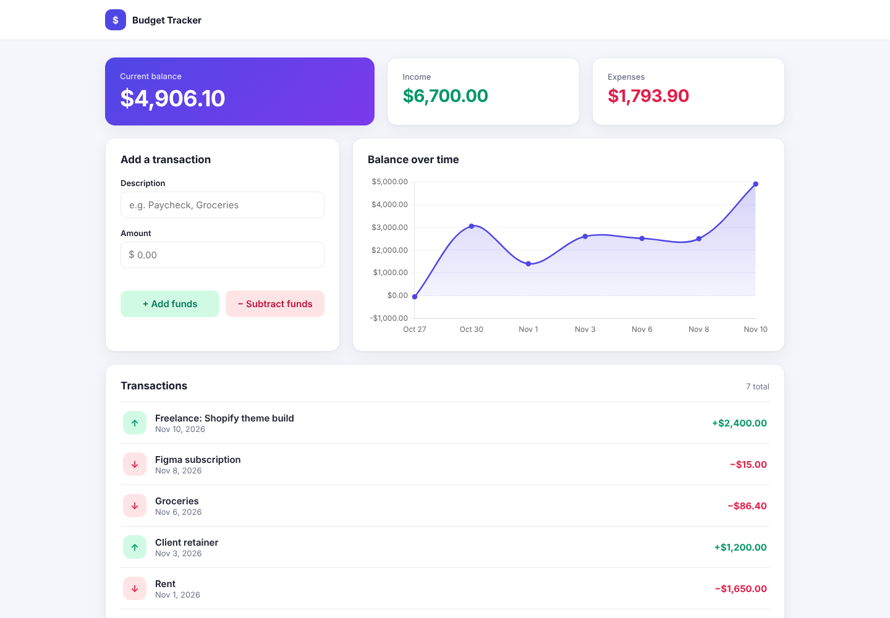

# Budget Tracker (PWA)

Track deposits and expenses with a running balance and a chart of your balance over time. It works offline: transactions added without a connection are stored on the device and synced automatically when you're back online.



## Features

- Balance, income and expense summary cards
- Add funds / subtract funds with validation (supports cents)
- Balance-over-time line chart (Chart.js)
- **Offline support:** service worker caches the app; offline entries are saved in IndexedDB, marked "waiting to sync", and bulk-uploaded on reconnect
- Installable as a Progressive Web App
- Responsive layout

## Built with

Node.js, Express, MongoDB with Mongoose, Chart.js, Service Worker API, IndexedDB.

## Run locally

1. Start MongoDB locally (or set `MONGODB_URI` to a MongoDB Atlas connection string).
2. Install and start:
   ```bash
   npm install
   npm start
   ```
3. Open http://localhost:3001.
